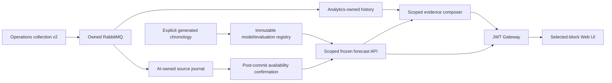

# M4 bounded engineering delivery — 2026-11-10

**The approved remaining-M4 implementation and local generated verification are delivered. Owner functional acceptance remains OPEN.** Work stayed exclusively within M4 and its required cross-repository integration. No next milestone has started; the owner selects it by prompt.

Authority is the [actual 2026-11-09 approval](M4_DELIVERY_APPROVAL_2026_11_09.json) of [revision 1](M4_DELIVERY_PACKAGE.md), SHA-256 `befbee78062c2fcef6af0ea394fcc81be3e7638053deca142f136c66bc7cc93d`. D01–D10 authorized the observed dry/wet mass scope, deterministic assistant substitution and conforming contract/release/pin/SQL engineering gates. The approved package and prior accepted artifacts were preserved. This report does not convert package approval or engineering tests into owner acceptance, scientific yield validation or production readiness.

## Delivered behavior

Independent local releases: Contracts **0.13.0**, AI **0.2.0**, Web **0.8.0**, Gateway **0.3.0**. Infrastructure adds owned-fixture verification without changing existing stack/image selection or default topology. Analytics, Operations and Telemetry retain their accepted contracts/implementations. No parent repository/build, sibling runtime source dependency, shared persistence model or cross-service SQL was introduced.

The selected-block UI now reads exact dry/wet forecast, last-day comparator, eligible actuals/residuals and uncalibrated anomaly flags. It exposes immutable model/evaluation records, forward metrics including worse results, source cutoffs and inspectable same-scope evidence links. Missing history, pending DRC, conflicts, unavailable references and absent labels remain explicit. Scope/account/visibility changes clear/cancel protected state; superseded intents and record reads cancel within the same block too. Raw evaluation details are collapsed behind a readable metrics table.

AI owns a minimal append-only collection revision journal and immutable registry. The live journal retains actual receipt/admission time and a separate conservative availability confirmation obtained **after the source transaction commits**. A missing confirmation makes live reads unavailable until explicit duplicate-safe recovery; it is never guessed from pre-commit timestamps. Exact database commit instant is not claimed. Source conflicts use the corresponding confirmed availability, so discovering a later conflict cannot rewrite an earlier cutoff. Generated historical evaluation has a distinct fixture-assigned availability policy, dataset hash and visible chronology mode. Current corrected Analytics totals are never represented as yesterday's knowledge.

Both seven-calendar-day means and previous-calendar-day comparators use exact Decimal arithmetic and accepted source-rounded kg. Dry output withholds on pending DRC; NONE stays unknown, and observed void-only zero is distinguished from absent observations. Frozen label evidence requires the next local midnight explicitly. Fixed residual thresholds are strictly greater than 5.000 wet kg / 1.000 dry kg; equality does not flag. No weather feature, inferred rainfall total or causal environmental/yield relationship is introduced.

The assistant uses **DETERMINISTIC_EVIDENCE_V1**, closed intents and versioned templates. It explains the frozen prediction/anomaly and authorized current production evidence; the API also supports an explicit optional environmental evidence window. Missing evidence produces partial/refused output, and denied evidence fails closed. All quantitative claims link to server-constructed same-scope forecast/model/evidence paths. No free-text chat, model download, LLM/provider inference, training/promotion API, external delivery, paid provider call or agronomic action was enabled.

Existing ANL-02 environmental runtime/history/Web engineering evidence remains in [its verification record](ANALYTICS_ENVIRONMENT_ADAPTER_VERIFICATION.md). The new M4 connected drill exercises production-backed AI/evidence and the retained ANL-01 flow; it is not a fresh rerun of the entire MQTT/environmental pipeline. Optional environmental assistant scope/denial is covered by AI API tests. Owner connected ANL-01/02 acceptance stays separate.



## Working demonstration and measured results

Final owned connected project **agrosphere-3a-check-b1650f0a**: **PASS**, with matching packaged/current AI source hashes, default-disabled ownership gates, real PostgreSQL/RabbitMQ, existing Operations event publication, Gateway, Keycloak Code/PKCE and a real browser. [Machine record](m4-evidence/connected-final-b1650f0a.json), [retained Analytics regression](m4-evidence/analytics-final-b1650f0a.json), [final screenshot](m4-evidence/m4-final-live.png).

The journal retained **136** minimal event/fingerprint facts: seven actual generated Operations outbox envelopes replayed unchanged to AI, 126 explicit generated historical revisions, and three bounded concurrency/conflict/commit-confirmation probes. These are not 136 distinct plantation collections. Replaying 126 corpus revisions in reverse adds no duplicate fact. Four immutable model records and one generated evaluation were registered; restart/reimport preserve their identities. The corpus contains 63 calendar dates, with 7 warm-up / 28 training-period / 14 validation / 14 locked test dates; no training/tuning or favorable test selection occurs.

The final synthetic target's wet forecast was **68.000 kg**, previous-day comparator **71.000 kg**, actual **82.000 kg**, residual **14.000 kg**. Dry forecast/comparator/actual/residual were **13.600 / 14.200 / 16.400 / 2.800 kg**. Both residual rules flagged. The UI and API also demonstrated insufficient-history withholding and honest live-first-receipt withholding; imported historical dates were not backdated into live knowledge.

| Locked test result | Seven-day mean MAE kg | Last-day comparator MAE kg | Scored dates per method | Absolute error sum: mean / comparator kg |
|---|---:|---:|---:|---:|
| Observed wet mass | 4.714286 | 1.714286 | 14 | 66.000 / 24.000 |
| Observed dry mass | 0.942857 | 0.342857 | 14 | 13.200 / 4.800 |

The mean is **worse than the comparator** on both synthetic targets. These results remain visible. Train/validation/test metrics, exact numerators/denominators and synthetic anomaly confusion counts are retained in the machine record. Synthetic anomaly truth is a declared fixture label, not agronomic ground truth; scores demonstrate mechanics, not plantation accuracy or calibrated confidence.

The connected drill exercised real concurrent duplicate handling (one effect), transaction rollback, runtime DDL/TEMP/UPDATE/DELETE/TRUNCATE and cross-DB denial, private broker configuration/domain-publish/quarantine-read denial, wrong-role and cross-estate denial, trusted conflicts without frozen-registry replacement, restart/replay, mandatory-diagnostic failure retaining input and explicit recovery. It also interrupted processing after source commit but before availability confirmation, verified that live reads withhold, and recovered without exposing the fact at its earlier admission cutoff. The browser inspected model/evaluation evidence and then signed in as the generated worker to verify that the protected AI workspace was unavailable.

Separate owned project **agrosphere-3a-check-e310ac24**: [nonempty upgrade PASS](m4-evidence/nonempty-upgrade-final.json). Fresh 0001 was seeded with a processed-event and outbox record; wrong-target migration was denied with the ledger/data unchanged; correct 0002 preserved both before/after PostgreSQL JSON row hashes and added seven AI tables. Those hashes are MD5 equality checks on synthetic rows, not security attestations. Its container, anonymous volumes, network, image tag and temporary credentials were removed.

## Actual checks

Counts are final suite counts, not sums of overlapping reruns. Exact artifact/source/Git observations and commands are in [the final evidence inventory](M4_FINAL_EVIDENCE_2026_11_10.json). Failures/retries are retained in [execution attempts](M4_EXECUTION_ATTEMPTS_2026_11_10.json).

| Owning repository / command | Actual outcome |
|---|---|
| Contracts: `.venv/Scripts/python.exe scripts/validate.py`; `-m unittest discover -s scripts -p test_*.py -q`; candidate generation check | PASS; **97 tests**, including retained historical byte/compatibility checks. Exact local release/archive and independent AI/Web pins verified |
| AI: `.venv/Scripts/python.exe -m pytest -q -p no:cacheprovider`; `-m compileall -q src migrations` | PASS; **67 tests** covering chronology/leakage/arithmetic/DST/registry, signed RSA JWTs and scope-before-ports, closed intents/evidence/refusal/optional environment denial, resource admission and commit/confirm/ACK ordering |
| AI: isolated `pip wheel . --no-deps ...`; exact ZIP resource/source checks | PASS; final 0.2.0 wheel includes seven exact API/schema/example pins and the final seven-table SQL/source bytes. Runtime packaging also exercised by both real fixtures |
| Gateway: `mvnw.cmd -q verify`; independent Docker build in final connected run | PASS; **16 tests**. Host wrapper used Java 27 with Java 25 target; generated runtime image builds/runs on its declared Java 25 toolchain |
| Web: locked `npm ci`; lint; format:check; typecheck; api:check; test; build | PASS; **111 unit tests**. Added state test covers within-block superseded intent/evidence cancellation. Known Cesium CommonJS warnings remain |
| Web: `npm run e2e`, then graphics, plus connected production-live and m4-live in their owned fixtures | PASS; **36 UI**, **1 software graphics**, **1 retained production-live**, **1 M4 live**. Suites were sequential. The final small within-block cancellation refinement was verified separately by unit/type/lint/build checks; the recorded connected walkthrough precedes that refinement |
| Web: `python scripts/verify-environment-package.py` | PASS; [Web 0.8.0 public-source packaging](m4-evidence/web-0.8.0-final-packaging.json), generated config only, Nginx/SPA/health assertions and owned cleanup. The final inventory records the last packaging fingerprints |
| Infrastructure: validator, Python syntax checks, `verify_m4.py`, `verify_m4_upgrade.py` | PASS; actual connected, recovery, privilege, nonempty-upgrade, rollback and teardown results above |
| Architecture: `python scripts/validate.py --workspace C:\Projects\agrosphere`; local coordination/evidence link checks | PASS; independent-root/workflow/structure checks and current links. No diagrams or hosted CI are represented as freshly rendered/executed |

Initial failures were repaired within the approved scope: missing Windows timezone data, old Contracts release-version guards after promotion, a broad retained badge locator, a connected forecast timeout without retained HTTP status, Docker build output decoding, wheel build-environment permissions/backend availability and new-header formatting. The timeout's original cause was not independently proven; fresh generated sessions, batching, bounded diagnostics and current-source checks resolved subsequent runs without relaxing JWT expiry. Both failed owned projects were removed. The earlier successful connected run preceded final availability hardening and is retained as scoped historical evidence, not proof of that later change.

The selected newly added Python dependencies reported no version-listed PyPI vulnerabilities at inspection; [review scope/licenses](../../../agrosphere-ai-service/docs/M4_DEPENDENCY_REVIEW_2026_11_10.json) are explicit. The full locked Web audit reports **25 moderate development-tool findings**, while the production-only audit reports **zero**. No forced upgrades/downgrades or dependency-policy rewrite was applied. This is not a comprehensive security certification; the existing build-tool findings remain a limitation.

## Reproduce the bounded demonstration

Use each independent repository's documented environment/toolchain. Build Web with its locked dependencies and generated/pin checks, then run from Infrastructure:

```powershell
python scripts/validate.py
python scripts/verify_m4.py
python scripts/verify_m4_upgrade.py
```

The harnesses allocate new random ownership-labelled projects/credentials/ports, never load the developer's existing `.env`, build independent service artifacts, generate their own corpus and register its immutable evaluation. The first harness drives real PKCE/Web: choose the canonical block, enter the emitted dataset/cutoffs, inspect forecast/anomaly/model/test metrics, request an evidence explanation and open links; it also exercises missing history, wrong-role/cross-estate access and recovery. Browser fixtures carry generated credentials only, traces are off, and their files live only inside the owned temporary directory. Sanitized reports are written to `Infrastructure/target/m4-platform.json` and `m4-upgrade.json`; a synthetic screenshot is retained by Web.

Resources are short-lived and removed in `finally`; the demonstration intentionally does not leave a running stack or reusable actual account behind. No backup/raw export is created. All owned DB/broker/log/container/corpus/credential copies exercised by these harnesses are bounded by verified owned teardown; this does not claim an unattended production deletion SLA or inspect unrelated Windows/Docker resources.

## Remaining limits and handoff

Engineering completion is limited to accepted D01–D10/E01–E10 and generated-only controls. Forecasts describe observed collected mass, not complete plantation yield, dry-rubber per hectare/tree, agronomic validation or an operational alert. Uncertainty and thresholds are uncalibrated. The assistant is deterministic; no live Ollama/LLM was delivered, per explicit approved D07 substitution. Provider spend is zero; local machine/storage/electricity cost is unmetered.

Hosted CI, production/external security, real source clocks/availability coverage, scale/load/SLA, general deployment/restore/retention and real-data eligibility are not established. Reference-device FPS, Android/offline/sync/English–French, broad M1 scope/load, M3 connected/privacy acceptance and physical M5 Unreal/VR/MR remain in the [sole completion checklist](../roadmap/PROJECT_COMPLETION_CHECKLIST.md). ANL/TLM and other earlier bounded approvals/evidence are preserved; none is silently removed or repeated.

This work changed only the M4 owning roots and preserved existing private configuration/data and stacks. The final read-only Git audit found that all seven recorded HEADs advanced (each starting HEAD remains an ancestor) and index bytes changed; staged diffs remained unchanged. No staging/commit/reset/push/publication command was issued by this agent, and the cause of those metadata advances was not independently established. They were left intact rather than restored or rewritten; [exact observations](M4_GIT_OBSERVATIONS_2026_11_10.json) distinguish this from byte-for-byte Git metadata preservation. Tested source, exact contract pins/archives and historical checkpoint suffixes were verified separately. No production deployment, REAL enablement or AEO action was performed by this work; no whole-machine or external Git-publication attestation is made.

**Next action:** the owner reviews the working M4 results and accepts or rejects the bounded functional outcome. Engineering does not self-accept it. Stop here and wait for the owner's next milestone prompt; do not begin M5 or another delivery track automatically.
